<p align="center">
  <a href="https://s00d.github.io/subly/">
    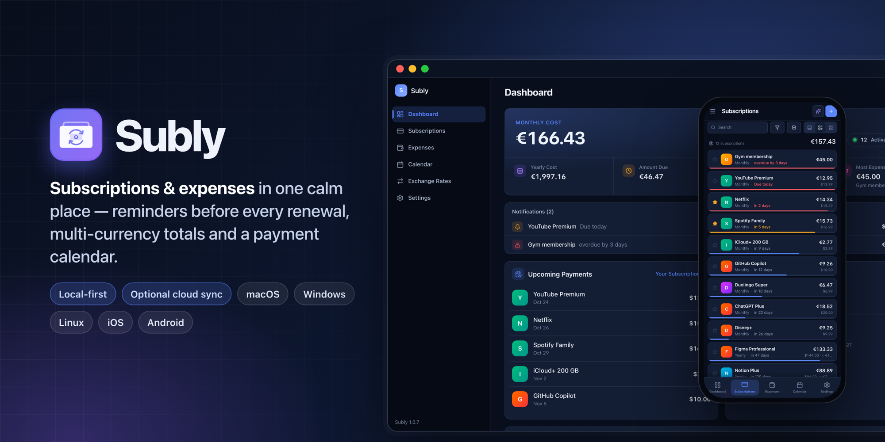
  </a>
</p>

<p align="center">
  <a href="https://github.com/s00d/subly/releases"></a>
  <a href="https://github.com/s00d/subly/releases"></a>
  
  
</p>

<p align="center">
  <strong>Track subscriptions and everyday spending in one calm place.</strong><br />
  Reminders before every renewal, totals in your main currency, a payment calendar — your data stays on your device, cloud sync is optional.
</p>

<p align="center">
  <a href="https://s00d.github.io/subly/"><b>Website</b></a> ·
  <a href="https://apps.apple.com/app/subly-money-tracker/id6767137924"><b>App Store</b></a> ·
  <a href="https://github.com/s00d/subly/releases/latest"><b>Download</b></a> ·
  <a href="CHANGELOG.md"><b>Changelog</b></a>
</p>

---

## Contents

- [Download](#download)
- [Screenshots](#screenshots)
- [Features](#features)
- [Privacy](#privacy)
- [Tech stack](#tech-stack)
- [Development](#development)
- [Testing](#testing)
- [Releases & CI](#releases--ci)
- [License](#license)

## Download

| Platform | Where | Notes |
|---|---|---|
| **macOS** | [App Store](https://apps.apple.com/app/subly-money-tracker/id6767137924) · [DMG](https://github.com/s00d/subly/releases/latest) | Universal (Apple Silicon + Intel) |
| **iPhone & iPad** | [App Store](https://apps.apple.com/app/subly-money-tracker/id6767137924) | Home-screen widget |
| **Windows** | [Installer (`.exe` / `.msi`)](https://github.com/s00d/subly/releases/latest) | |
| **Linux** | [`.AppImage` / `.deb` / `.rpm`](https://github.com/s00d/subly/releases/latest) | |
| **Android** | [APK](https://github.com/s00d/subly/releases/latest) | Home-screen widget |

GitHub builds are free. The App Store version is paid — buying it supports development.

## Screenshots

### Desktop

<p align="center">
  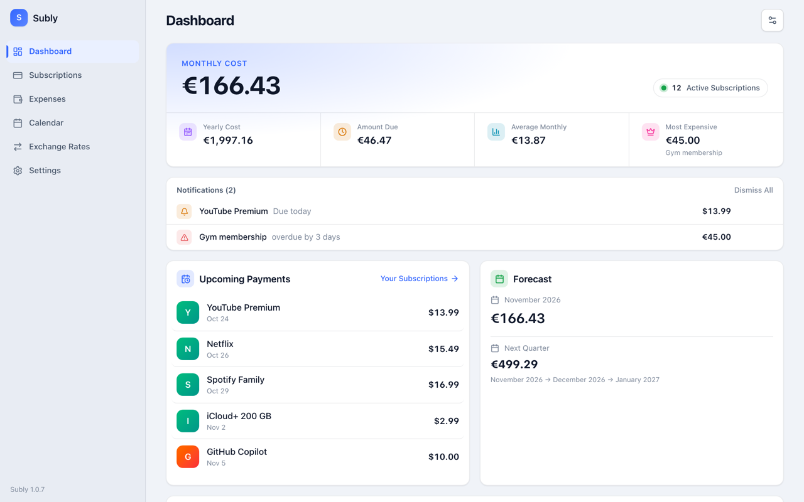
  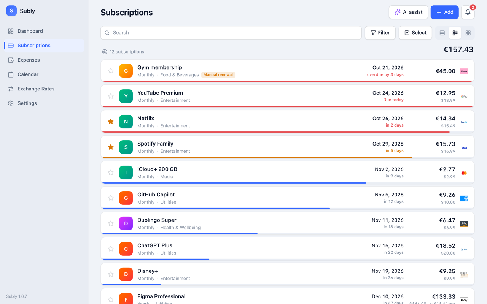
  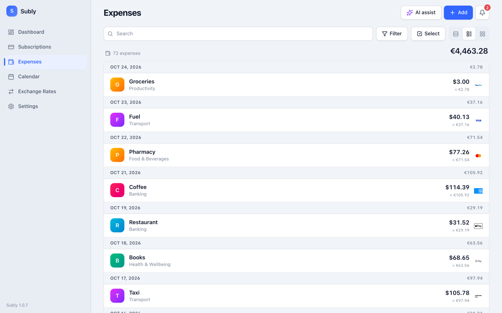
</p>
<p align="center">
  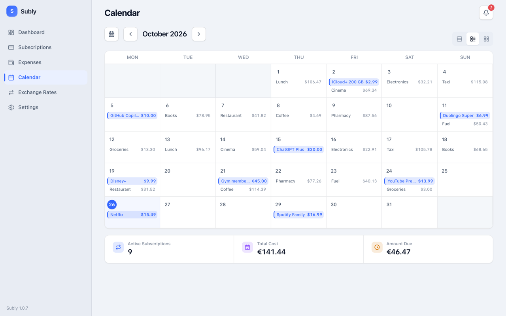
  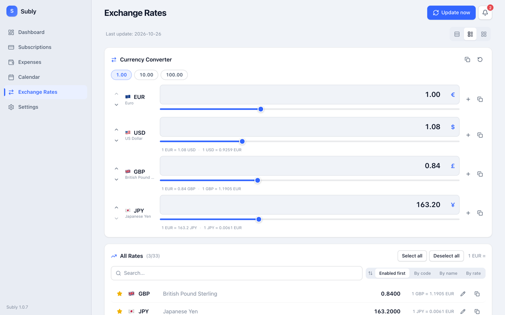
  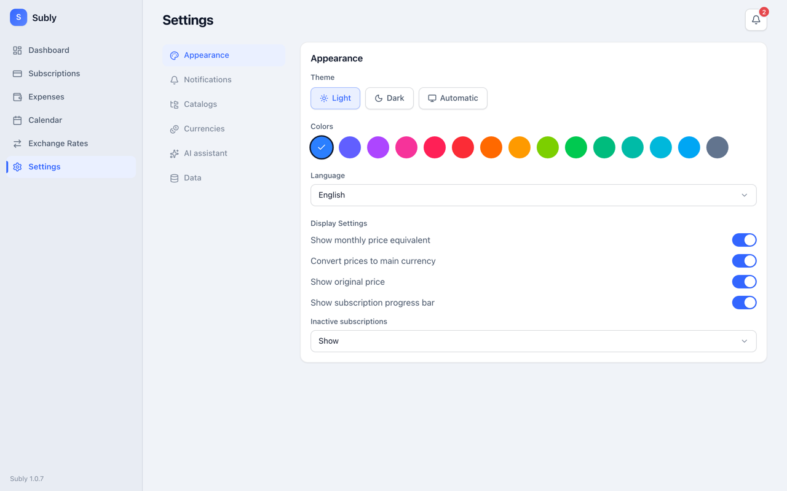
</p>

### Mobile

<p align="center">
  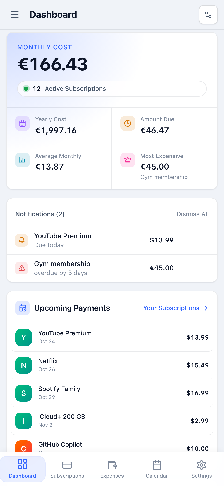
  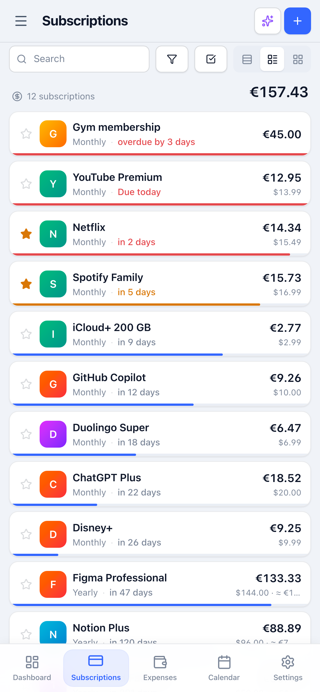
  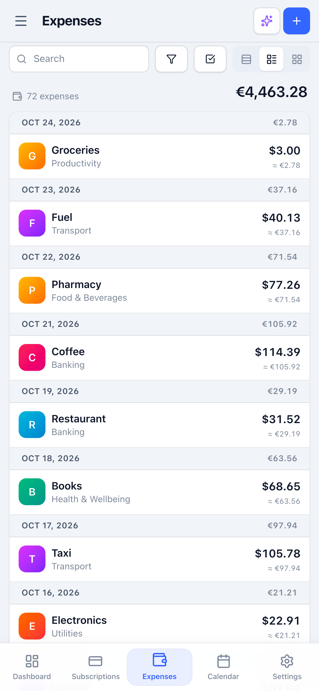
  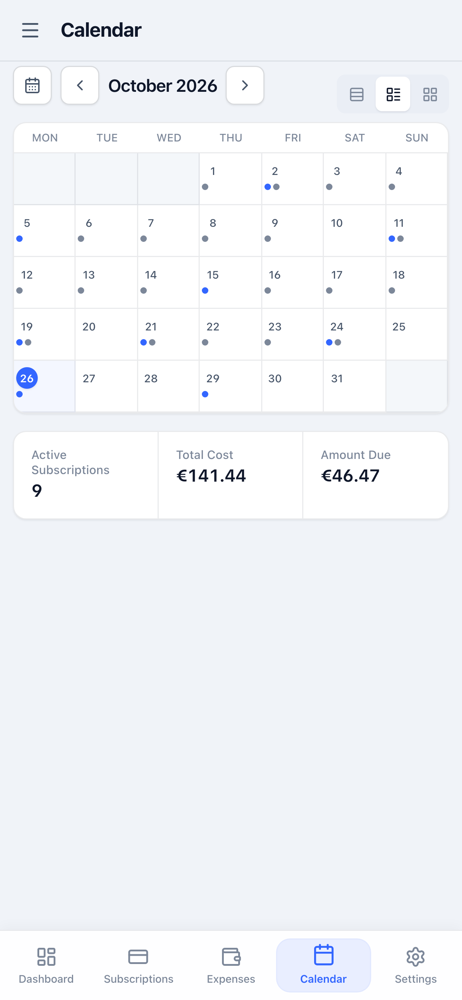
</p>

### Dark theme

<p align="center">
  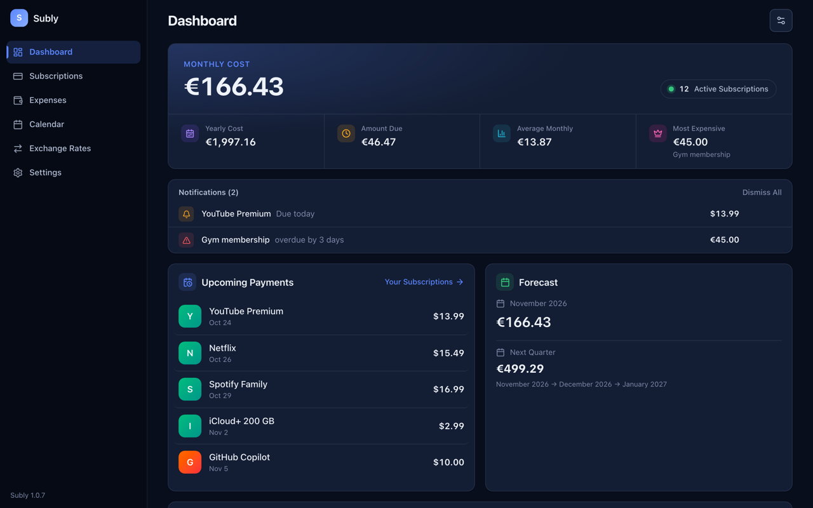
  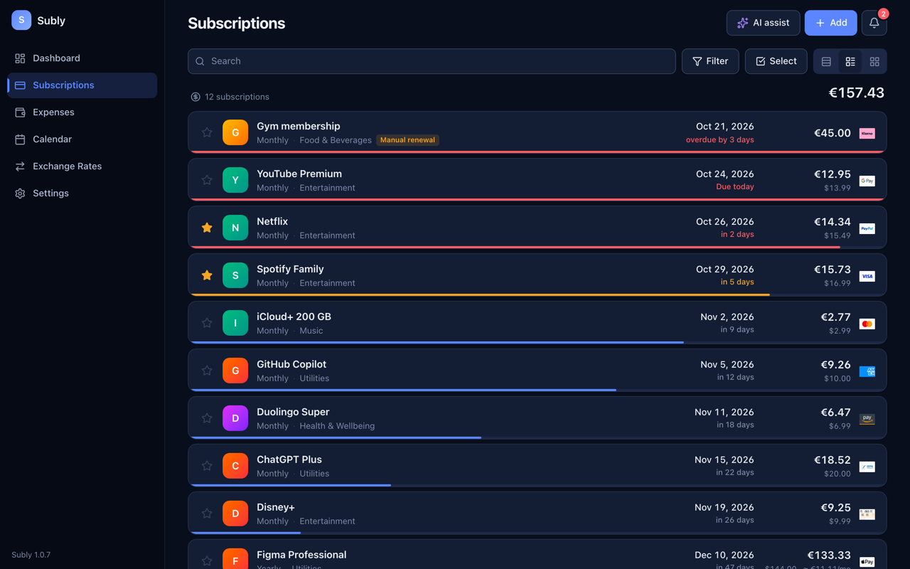
</p>
<p align="center">
  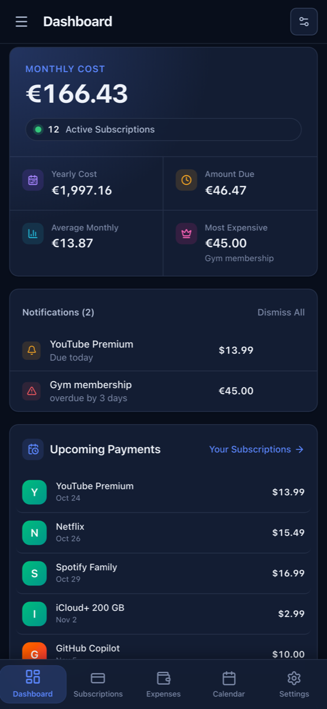
  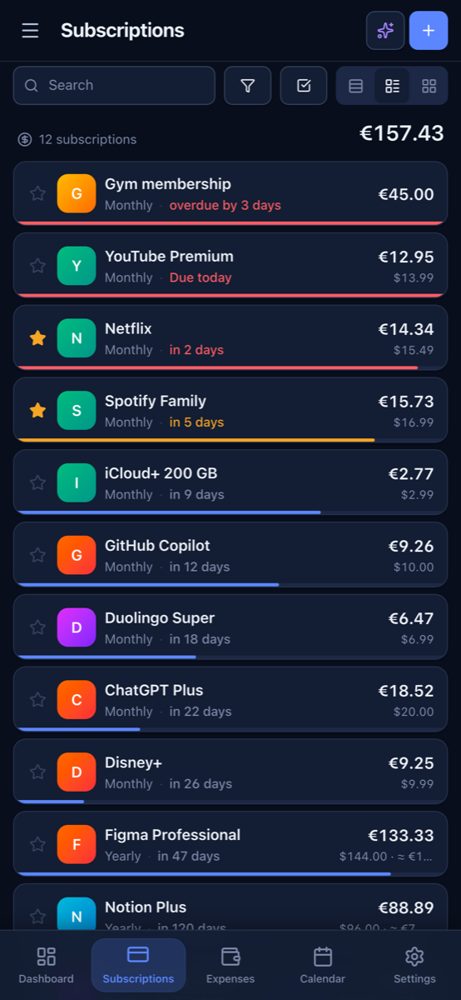
  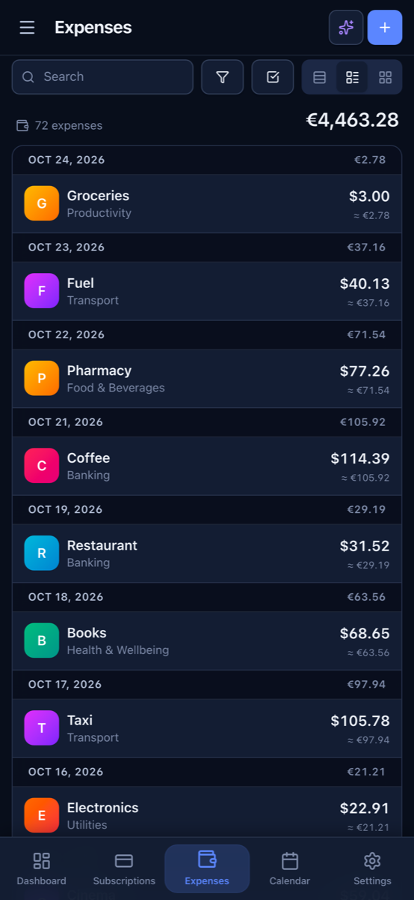
  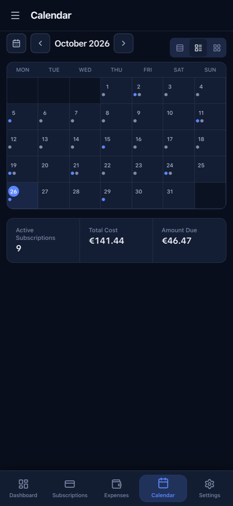
</p>

**Video walkthrough:** [desktop with audio](https://github.com/s00d/subly/raw/main/store-assets/video/store-walkthrough-desktop-with-audio.mp4) · [desktop, no audio](https://github.com/s00d/subly/raw/main/store-assets/video/store-walkthrough-desktop.mp4) · [mobile](https://github.com/s00d/subly/raw/main/store-assets/video/store-walkthrough-mobile-with-audio.mp4)

## Features

<table>
<tr>
<td width="50%" valign="top">

**Subscriptions**
- Any cycle: daily, weekly, monthly, yearly, every N periods
- Price in the main currency, "due in N days" / overdue hints, cycle progress bar
- Categories, tags, payment methods, household members
- Group by category or payment method, with monthly totals per group
- Three list layouts, favorites, batch actions
- Payment history and manual or automatic renewal

</td>
<td width="50%" valign="top">

**Expenses**
- One-off purchases with category, tags, notes and payer
- Daily totals right in the list
- Filters by period, category, payment method and tag
- CSV export

**Dashboard & calendar**
- Monthly and yearly cost, amount due, budget usage
- Spending trend, category and payment-method splits, forecast
- Payment calendar: month, week and list views with monthly stats

</td>
</tr>
<tr>
<td valign="top">

**Reminders**
- System notifications N days before a payment, on the day, and when overdue
- Morning, evening or custom time
- Optional Telegram bot alerts
- Tray menu (desktop) and home-screen widgets (iOS, Android)

**Currencies**
- 34 currencies built in, custom ones supported
- Automatic rates: Frankfurter (no key), Fixer.io, APILayer, Open Exchange Rates, ExchangeRate-API, CurrencyAPI
- Converter with presets and rate history

</td>
<td valign="top">

**Sync & data**
- Optional sync: iCloud, Google Drive, Dropbox, OneDrive, WebDAV
- Backups to `.subly`, export to JSON / CSV, CSV import

**AI assist** (optional, your own key)
- Add subscriptions or expenses from text, a receipt or a screenshot
- OpenAI, OpenRouter, Gemini, Groq, DeepSeek, Mistral or any OpenAI-compatible endpoint
- Every row is previewed before it is saved

**Everywhere**
- Light, dark and system themes, 15 accent colors
- 12 languages: English, Русский, 中文, Español, Français, Deutsch, Português, 日本語, 한국어, العربية, हिन्दी, Türkçe

</td>
</tr>
</table>

## Privacy

Subly is **local-first**: subscriptions, expenses and settings live in a local database on your device and work offline. Nothing leaves the device unless you turn on cloud sync, exchange-rate updates, Telegram alerts or AI assist. Sync goes to *your* iCloud / Drive / Dropbox / OneDrive / WebDAV, and secrets (API keys, tokens, saved logins) are kept in the system keychain.

## Tech stack

| Layer | Stack |
|---|---|
| App shell | [Tauri v2](https://v2.tauri.app/) — desktop and mobile from one codebase |
| UI | [Vue 3](https://vuejs.org/) (`<script setup>`), [Pinia](https://pinia.vuejs.org/), [vue-i18n](https://vue-i18n.intlify.dev/) |
| Styling | [Tailwind CSS v4](https://tailwindcss.com/) + [tailwind-variants](https://www.tailwind-variants.org/), [Lucide](https://lucide.dev/) icons |
| Charts | [ECharts](https://echarts.apache.org/) via vue-echarts |
| Validation | TypeScript + [Zod](https://zod.dev/) |
| Backend | Rust: [redb](https://github.com/cberner/redb) storage, `rust_decimal` money math, sync providers, notification scheduler |
| Widgets | WidgetKit (iOS), Jetpack Glance (Android) |

All business logic lives in Rust (`src-tauri/src/commands/`). The Vue app calls it through typed clients in `src/services/*Client.ts`.

<details>
<summary><b>Project structure</b></summary>

```
subly/
├── src/                      # Vue app
│   ├── pages/                # Dashboard, Subscriptions, Expenses, Calendar, Rates, Settings
│   ├── components/           # Feature components + ui/ primitives
│   ├── services/             # *Client.ts — typed wrappers over Tauri commands
│   ├── stores/               # Pinia stores
│   ├── schemas/              # Zod schemas and DTO parsing
│   ├── locales/              # 12 translation files
│   └── dev/                  # UI mock: IPC record/replay for browser-only development
├── src-tauri/
│   ├── src/commands/         # Rust commands: subscriptions, expenses, dashboard, rates, sync, ai, notifications…
│   ├── gen/apple, gen/android
│   └── tauri.conf.json
├── landing/                  # Marketing site (GitHub Pages)
├── store-assets/             # Store screenshots, banner, videos
├── docs/                     # Architecture and design notes
└── .github/workflows/        # Builds, store uploads, tests, Pages
```

</details>

## Development

**Requirements:** Node.js ≥ 20, pnpm ≥ 9, Rust stable, plus the [Tauri prerequisites](https://v2.tauri.app/start/prerequisites/) for your OS.

```bash
git clone https://github.com/s00d/subly.git
cd subly
pnpm install

pnpm tauri dev      # run the app
pnpm tauri build    # production bundle → src-tauri/target/release/bundle/
```

**UI without the Rust backend.** `pnpm dev` serves the Vue app in a regular browser and answers app commands from recorded fixtures (`.dev/ipc-fixtures.json`, recorded while `pnpm tauri dev` runs). Add `?lang=ru&theme=dark` to the URL to switch language and theme. This is handy for design work and store screenshots.

**Mobile:** `pnpm tauri ios dev` / `pnpm tauri android dev` (Xcode, or Android Studio with JDK 17).

**Linux build dependencies:**

```bash
sudo apt-get install -y libwebkit2gtk-4.1-dev libappindicator3-dev librsvg2-dev patchelf libssl-dev
```

**Icons:** `pnpm tauri icon app-icon.svg`

## Testing

```bash
pnpm build                 # type-check + production frontend build
pnpm test:backend          # Rust unit and integration tests
pnpm test:restart-smoke    # persistence across restarts
pnpm test:ios-widget       # iOS widget JSON contract (Xcode)
pnpm test:android-widget   # Android widget contract (JDK 17)
pnpm test:known-risks      # known persistence risks (expected to fail until fixed)
```

## Releases & CI

- Pushing a `v*` tag builds macOS (universal), Windows and Linux (`build.yml`) and the Android APK (`android-release.yml`), and attaches them to the GitHub release.
- App Store builds are uploaded with `appstore-ios.yml` and `appstore-macos.yml` (manual dispatch).
- Version bumps across `package.json`, Tauri and Apple metadata: `pnpm bump:version <semver>`.

## Support

If Subly saves you money, consider [buying it on the App Store](https://apps.apple.com/app/subly-money-tracker/id6767137924) or [donating](https://www.donationalerts.com/r/s00d88). Bug reports and ideas are welcome in [Issues](https://github.com/s00d/subly/issues).

## License

MIT
